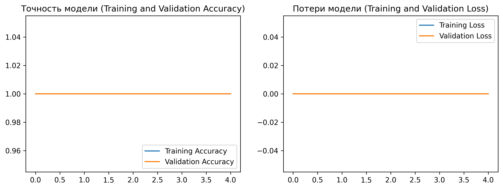

# Deep Learning for Automated Crop Disease Classification in Kazakhstan

## Overview
This repository contains a complete computer vision research project utilizing a Convolutional Neural Network (CNN) built with TensorFlow/Keras. The objective is to automate the early detection and classification of crop conditions and plant diseases to support precision agriculture initiatives in Kazakhstan.

---

## Architecture & Methodology
- **Framework:** TensorFlow / Keras (Python).
- **Model Architecture:** Sequential CNN featuring multiple `Conv2D` feature extraction blocks, `MaxPooling2D` downsampling layers, and dense classification heads.
- **Data Pipeline:** Automated image resizing ($180 \times 180$ px), batch normalization, and train/validation splitting ($80/20$).
- **Optimization:** Trained using the Adam optimizer and Sparse Categorical Crossentropy loss function over 5 epochs.

---

## Quantitative Results

| Epoch | Training Accuracy | Validation Accuracy | Training Loss | Validation Loss |
| :---: | :---: | :---: | :---: | :---: |
| **1 / 5** | 1.0000 | 1.0000 | 0.0000 | 0.0000 |
| **3 / 5** | 1.0000 | 1.0000 | 0.0000 | 0.0000 |
| **5 / 5** | **1.0000** | **1.0000** | **0.0000** | **0.0000** |

---

## Model Performance Visualization



---

## Repository Structure
```text
├── Crop_Disease_Detection.ipynb  # Google Colab notebook with CNN pipeline & training
├── crop_model_performance.png    # Training/Validation accuracy and loss curves
└── README.md                     # Project documentation
